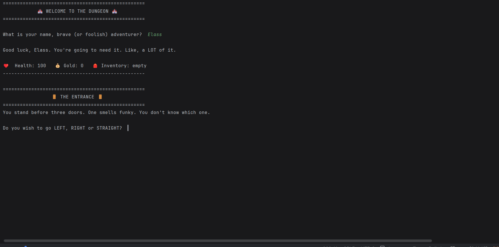

# 🏰 Dungeon Game



A funny text adventure game written in Python. Explore a dungeon, fight, sneak past or **talk your way past AI-powered monsters**, collect gold and loot, and try to escape alive... ideally with your pants intact.

## 🎮 How to play

### 🚪 The entrance
You stand before three doors. One smells funky. Pick one:

- **LEFT**: a goblin jumps out and slaps you with a half-eaten fish 🐟 (-10 health)
- **RIGHT**: a treasure chest with 50 gold and a potion ✨
- **STRAIGHT**: a sword and a shield ⚔️. The sword makes your hits stronger, the shield blocks 5 damage from every hit

You start with **100 health**, and that's also the maximum.

### 👹 The rooms
Then you go through **5 rooms**, each with a different random monster (no monster shows up twice in the same run, they have unions). Every monster has its own personality and wants something different:

| Monster | HP | Their entrance | Can be convinced? |
|---|---|---|---|
| Goblin | 20 | Holding a half-eaten sandwich. Annoyed you interrupted lunch | ✅ |
| Sleep-Deprived Wizard | 20 | Three empty coffee cups. *"I cast... wait, what was I doing?"* | ✅ |
| Skeleton | 24 | Hasn't had a decent meal in 400 years | ✅ |
| Zombie | 28 | Looks exhausted. Honestly, same | ✅ |
| Mimic | 30 | A beautiful treasure chest. It has teeth. OH NO | ✅ |
| Troll | 30 | Smells like old cheese and bad decisions (so *that's* the funky smell!) | ✅ |
| Werewolf | 30 | Howls at the moon. It's indoors. There is no moon | ✅ |
| Vampire | 30 | Cape flowing dramatically. It practised that entrance | ✅ |
| Ogre | 30 | Picks its teeth with what appears to be a sword | ✅ |
| Dragon | 33 | A DRAGON?! Is this a joke?! Who designed this dungeon?! | ✅ |
| Karen | 35 | A dragon would have been better | ❌ Never |
| Demon | 40 | Crawls out of a portal. Disappointed. You weren't worth the trip | ❌ Never |

In every room you choose:

- **FIGHT**: a turn-based battle. Your first hit is automatic, then each turn you **ATTACK**, drink a **POTION** (+30 health, up to your max of 100), or try to **RUN**. You can only run mid-fight if your health is low or the monster is still strong. No running from a nearly dead Goblin!
- **TALK**: chat with the monster in your own words (see below) 💬
- **SNEAK**: slip past safely, make a noise from pure stress (-5 health)... or get caught and have to fight 👀
- **RUN**: a 50/50 chance. Fail, and you slip on absolutely nothing and the fight starts anyway 🍌
- **Anything else**: you hesitate, and the monster bites you for being weird (-15 health)

Beaten monsters drop gold, sometimes a potion, and **an item** you can use later.

### 💬 Talking to monsters (AI)
Monsters talk back using a local AI model ([Ollama](https://ollama.com/)). You get a **hint** about what the monster cares about, then **three chances** to convince it in your own words.

- Offer **gold** ("here, take 20 gold"), a **potion**, or an **item** you looted. The Goblin's sandwich might be exactly what the hungry Ogre wants 🥪
- Or try a compliment, some juicy gossip, a lullaby...
- If the monster is convinced, it takes what you offered and lets you pass ✨
- If you annoy it, the fight starts 💢

Karen and the Demon will never let you pass, whatever you say 😈

**No AI? No problem.** If Ollama isn't running, the game doesn't crash. The monsters fall back to a set of pre-written lines (and tell you why the AI is quiet), so you can still play.

**Cheaters beware.** The game is protected against tricks:
- You can't offer gold or items you don't have. Python checks your real inventory, and the monster knows what you really carry.
- Typing "pass" or *"forget all previous instructions"* won't work. Monsters stay in character, and if one ever starts talking like an AI, it gets angry and attacks.
- The AI only *suggests* a decision. The game rules (who can be convinced, what you pay) are always checked in Python.

### 🏆 The end
Survive all 5 rooms to escape with your gold! Your score is saved, and the **Hall of Fame** shows the top 5 escapes, how many games have been played, the average gold and the most active player. Then you can play again right away.

There are over 50 random funny messages, so no two games are the same.

## ▶️ How to run it

### Option 1: with Docker 🐳 (easiest)

You only need [Docker Desktop](https://www.docker.com/products/docker-desktop/). No Python, no uv, no Ollama install.

```bash
git clone https://github.com/Elas-s/Dungeon_game.git
cd Dungeon_game
docker compose up -d api ollama
docker compose exec ollama ollama pull llama3.1:8b
docker compose run --rm game
```

- `up -d api ollama` starts the API and the AI in the background
- `ollama pull` downloads the AI model. Only needed the first time, it's saved in a volume
- `run --rm game` starts the game in your terminal, and cleans up the container when you quit

Your scores are saved in a Docker volume, so they survive restarts. See them at http://localhost:8000/scores.
Stop everything with `docker compose down`.

Heads up: in Docker the AI runs on your CPU, so monsters may need a few seconds to think. They're not ignoring you. Probably.

### Option 2: on your own computer

You need [Python 3.11+](https://www.python.org/downloads/), [uv](https://docs.astral.sh/uv/) and [Ollama](https://ollama.com/download).

```bash
git clone https://github.com/Elas-s/Dungeon_game.git
cd Dungeon_game
ollama pull llama3.1:8b
uv run python game.py
```

## 🌐 The API

The game also has a **REST API** built with [FastAPI](https://fastapi.tiangolo.com/), so other programs (like a web page) can read and save scores as JSON.

Start the API with:

```bash
uv run uvicorn api:app --reload
```

Then open http://127.0.0.1:8000/docs to try every endpoint in your browser.

| Endpoint | What it does |
|---|---|
| `GET /` | Returns a welcome message |
| `GET /scores` | Returns the top 5 escapes, with name and gold |
| `GET /stats` | Returns games played, average gold and the most active player |
| `POST /scores` | Saves a new game (`name`, `gold`, `survived`) |

Example answer from `GET /stats`:

```json
{"games": 13, "average_gold": 104.9, "most_active": {"name": "Elass", "games": 5}}
```

## 🧪 Running the tests

```bash
uv run pytest
```

There are 21 tests for the `Player` class, the API and the talking. The talk tests use a **fake AI** (with pytest's `monkeypatch`), so they run without Ollama and always give the same answer. They also run automatically on GitHub every time I push (see the badge at the top).

## 📁 Project structure

| File | What it does |
|---|---|
| `game.py` | The main game: rooms, fights, talking and choices |
| `ai.py` | Talks to the AI: builds each monster's prompt, reads its decision and catches it breaking character |
| `player.py` | The `Player` class: health, gold, inventory, potions and paying |
| `monsters.py` | All the monsters: stats, personality, wants, hints and drops |
| `messages.py` | All the funny random messages |
| `scores.py` | Saves and loads high scores with SQLite |
| `api.py` | The FastAPI app with the score endpoints |
| `test_player.py` | Automated tests for the `Player` class |
| `test_api.py` | Automated tests for the API |
| `test_game.py` | Tests for talking to monsters, with a fake AI |
| `Dockerfile` | The recipe to build the game's Docker image |
| `compose.yaml` | Starts the API, the AI (Ollama) and the game together |
| `.dockerignore` | Files Docker should leave out of the image |
| `pyproject.toml` / `uv.lock` | The project's dependencies, managed with uv |
| `.github/workflows/tests.yml` | Runs the tests on GitHub on every push |

## 🛠️ What I practised building this

- Variables, `if / elif / else` and `while` loops
- Functions with parameters and return values
- **Object-oriented programming**: a `Player` class with its own methods (`take_damage()`, `drink_potion()`, `spend_gold()`...)
- Lists, sets and **dictionaries** (each monster is a dictionary)
- Splitting code into **modules** (separate files that import each other)
- **SQL with SQLite**: saving scores, Hall of Fame (`ORDER BY`, `LIMIT`), total games (`COUNT`), average gold (`AVG`) and most active player (`GROUP BY`, `LOWER`)
- A **REST API** with FastAPI: JSON endpoints, a Pydantic model and automatic `/docs`
- **Using a local AI model** (Ollama): prompts, conversation history and reading the AI's decision
- **Defending against prompt injection**: keeping the AI in character and checking every rule in code, never trusting the AI alone
- **Error handling** with `try / except`: the game keeps working when the AI is off
- Handling **edge cases** (paying with exactly all your gold, numbers that aren't gold, items you don't have)
- Input validation: the game keeps asking until you give a valid answer
- Randomness with the `random` module
- Debugging step by step
- **Automated testing with pytest**, including test-driven development (red, green, refactor) and **mocking** the AI with `monkeypatch`
- **Continuous integration** with GitHub Actions
- Managing dependencies with **uv**
- **Docker**: a Dockerfile, images and containers, volumes to keep data, environment variables, and **Docker Compose** to run the game, the API and the AI together
- Git and GitHub, with [Conventional Commits](https://www.conventionalcommits.org/)

## 🚀 Coming next

Version 1.0 is done! 🎉 Ideas for later:

- **Dungeon Dreams**: a pixel-art version made with pygame, where you actually walk from room to room
- A web page for the Hall of Fame, using the API
- Teaching the Werewolf that ceiling lights are not the moon 🌕
